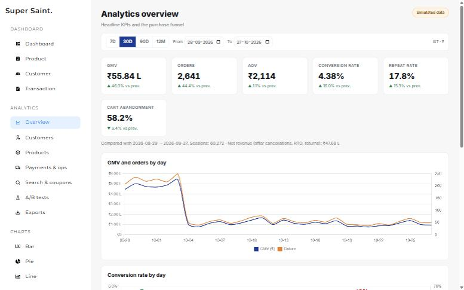
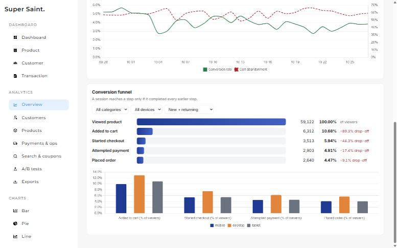
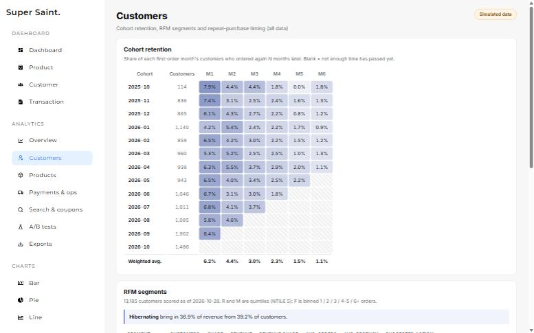
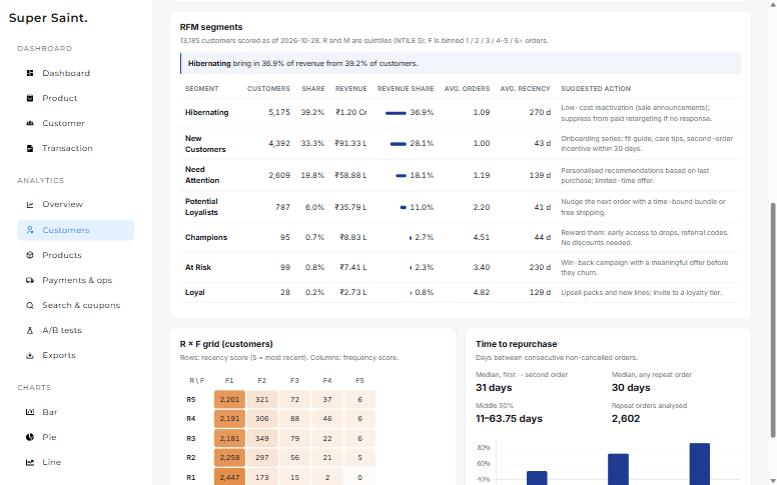
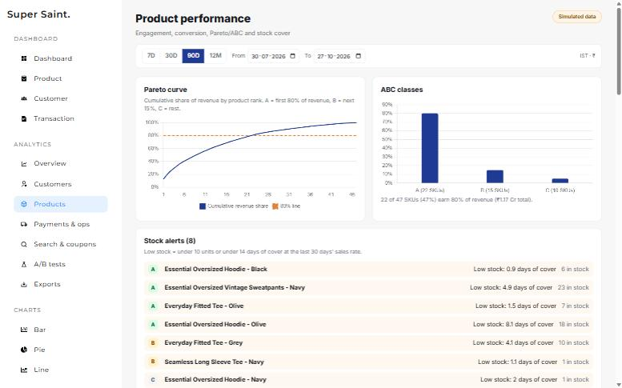
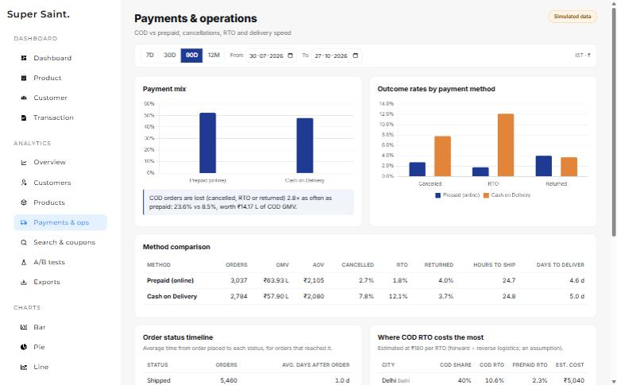
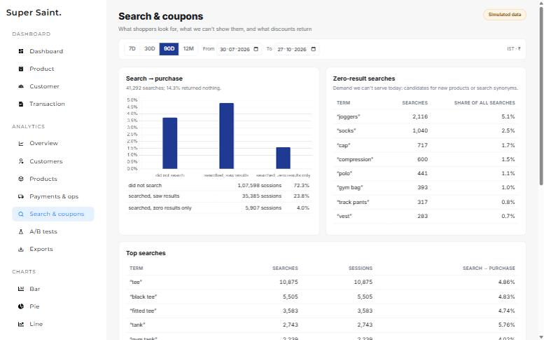
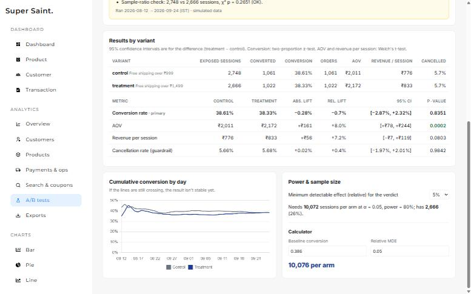

# Super Saint
Full stack e-commerce store for Super Saint fitted essentials, with an admin dashboard. (TypeScript + MERN)

## Tech Stack
FrontEnd - TypeScript, React, Redux Toolkit (RTK Query), Sass

BackEnd - TypeScript, Node.js, Express, MongoDB (Mongoose), JWT auth (bcrypt-hashed passwords)

Payments - Razorpay (UPI, cards, netbanking, wallets) and Cash on Delivery

## Run locally

1. Start MongoDB on `mongodb://127.0.0.1:27017`.
2. Backend:
   ```bash
   cd Backend
   cp .env.example .env      # set JWT_SECRET and ADMIN_PASSWORD
   npm install
   npm run build
   npm run seed              # sample catalog + admin account from .env
   npm start                 # http://localhost:4000
   ```
3. Frontend:
   ```bash
   cd Front-End
   cp .env.example .env
   npm install
   npm run dev               # http://localhost:5173
   ```

Log in as the admin from `Backend/.env` and open **Menu → Admin Dashboard** to manage products, orders, customers and coupons.

### Online payments: UPI, cards, netbanking (optional)
Payments go through [Razorpay](https://razorpay.com). Copy the Key ID and Key Secret from Razorpay Dashboard → Account & Settings → API Keys (test keys start with `rzp_test_`) into `Backend/.env`:
```
RAZORPAY_KEY_ID=rzp_test_...
RAZORPAY_KEY_SECRET=...
```
Restart the backend. Checkout will then offer "Pay online" (prepaid orders ship free). Without keys it offers Cash on Delivery only. Order totals are always calculated on the server, and payments are checked against Razorpay's signature before an order is created.

## Storefront
- Scrolling announcement bar, sticky header, slide-in menu, live search and cart drawer with free-shipping progress
- Collection page with filter and sort (category, price, sort), product pages with sizes, colour variants, size chart and accordions
- Email/password accounts, order history, order tracking with a status timeline
- Store copy, navigation, FAQs and policy pages live in `Front-End/src/config/site.ts`

## API auth
`POST /api/v1/user/register` and `POST /api/v1/user/login` return a JWT. Send it as `Authorization: Bearer <token>`. Admin routes check the token's user has `role: "admin"`.

## Analytics

An e-commerce analytics layer on top of the store: event tracking, a SQL warehouse, an admin analytics dashboard, an A/B testing module and Power BI/Excel exports.

> **The analytics demo runs on simulated data.** A deterministic simulator (fixed seed) generates 12 months of store activity into a separate `Ecommerce_sim` database: 463,465 sessions, 1,442,963 events, 16,655 orders, 13,809 customers. Your live store database is never touched. The dashboard shows a "Simulated data" badge whenever it is reading simulated records.

### Reproduce everything with one command

Requires MongoDB on `mongodb://127.0.0.1:27017` and `Backend/.env` (see `.env.example`).

```bash
cd Backend
npm install
npm run analytics
```

That runs, in order:

1. `npm run seed:sim`: simulate 12 months into `Ecommerce_sim` (~2 min)
2. `npm run export:warehouse`: load a DuckDB star schema (`analytics/warehouse.duckdb`) and CSVs (`analytics/warehouse/`)
3. `npm run sql`: run every query in [`analytics/sql`](analytics/sql) and save results to [`analytics/results`](analytics/results)
4. `npm run report`: build the report charts (`docs/charts`) and [`docs/report_numbers.json`](docs/report_numbers.json)
5. `npm test`: unit tests for the statistics and metrics, plus a consistency test checking the SQL results match the live API on the same data

Then open the dashboard on the simulated data:

```bash
npm run dev:sim
```

In a second terminal, run the frontend from `Front-End/` with `npm run dev`. Log in with `ADMIN_EMAIL` / `ADMIN_PASSWORD` from `Backend/.env` and open **Admin → Analytics**. Restart with `npm run dev` (not `dev:sim`) to go back to the live store.

### What's included

| Area | Where |
|---|---|
| Event tracking (product views, search, cart, checkout, payment, orders, coupons, experiment exposure), batched with `sendBeacon` | `Front-End/src/analytics/`, `Backend/src/controllers/events.ts` |
| Simulator: weekday/weekend patterns, festive sale spike, category seasonality, COD vs prepaid, cancellations/RTO/returns, coupons, repeat buyers | `Backend/src/scripts/simulate.ts`, `Backend/src/scripts/sim/world.ts` |
| Star schema (`fact_orders`, `fact_order_items`, `fact_events`, `dim_customers`, `dim_products`, `dim_date`, `kpi_daily`), no PII | `Backend/src/analytics/warehouse.ts` |
| 14 SQL queries (CTEs, `LAG`, `NTILE`, `FIRST_VALUE`, running totals, `GROUPING SETS`, quantiles) | `analytics/sql/` |
| Admin-only analytics API (MongoDB aggregations, covering indexes, 5-minute cache) | `Backend/src/analytics/service.ts`, `/api/v1/analytics/*` |
| A/B statistics: two-proportion z-test, Welch's t-test, 95% CIs, sample-ratio mismatch, sample-size calculator, verdict | `Backend/src/analytics/stats.ts` |
| Dashboard pages: Overview (KPIs vs previous period, funnel), Customers (cohorts, RFM), Products (ABC, stock cover), Payments & ops, Search & coupons, A/B tests, Exports | `Front-End/src/pages/admin/analytics/` |
| Power BI / Excel guide (relationships, DAX measures, pivots) | [`docs/powerbi.md`](docs/powerbi.md) |
| Findings report (7 insights, each with its query, numbers, chart and recommendation) | [`docs/analysis_report.md`](docs/analysis_report.md) |

All dates are bucketed in **IST** and money is in **₹**. Experiments are **off by default**, so every visitor gets the control experience (free shipping over ₹999) until an admin starts one.

### Screenshots

| | |
|---|---|
|  |  |
|  |  |
|  |  |
|  |  |

### Performance

API latency on the simulated dataset (median of 3 uncached runs on a laptop, `npm run bench`). Covering indexes on the events collection cut the 30-day queries from 1.4–3.1 s to the figures below. Cached responses return in about 2 ms.

| Endpoint | 30 days | 90 days | 365 days |
|---|---|---|---|
| KPIs | 186 ms | 453 ms | 1,493 ms |
| Funnel | 407 ms | 974 ms | 3,275 ms |
| Products | 144 ms | 324 ms | 1,135 ms |
| Payments | 35 ms | 58 ms | 138 ms |
| Search | 213 ms | 551 ms | 1,675 ms |
| Coupons | 14 ms | 26 ms | 66 ms |

Full-year questions are better answered from the DuckDB warehouse, where every query in `analytics/sql` runs in under 100 ms.
