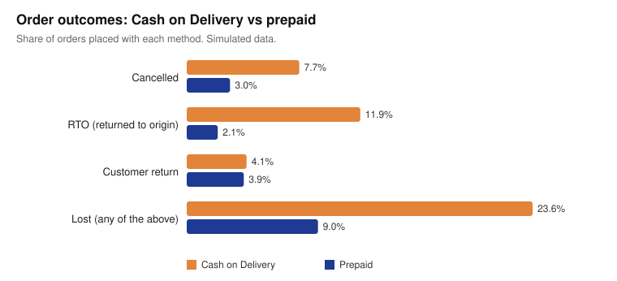
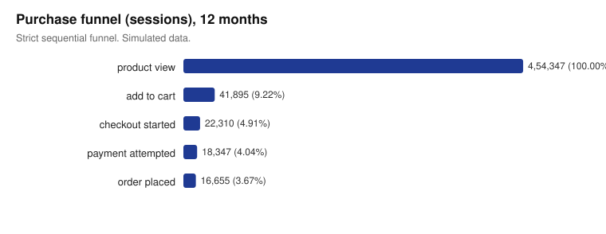
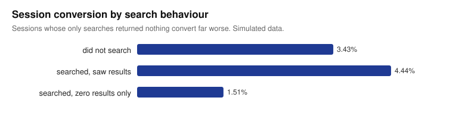
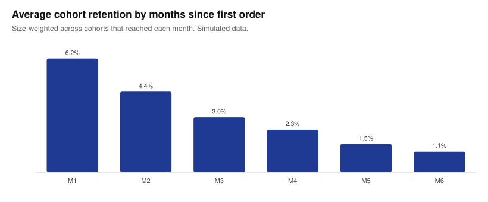
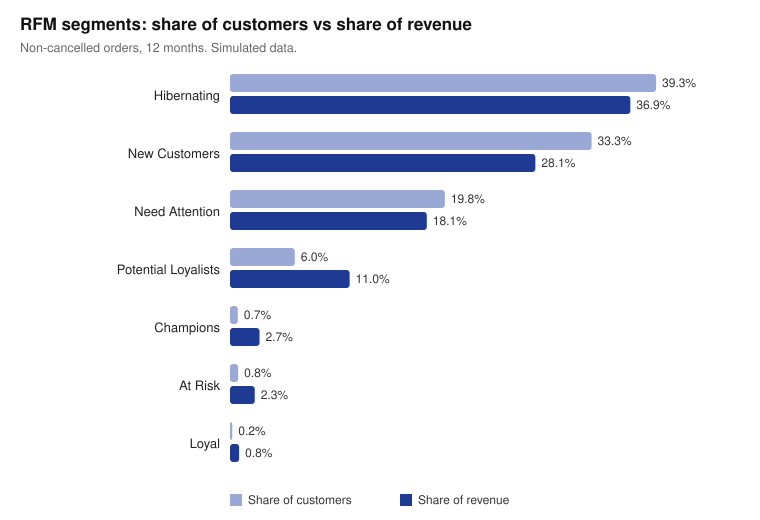
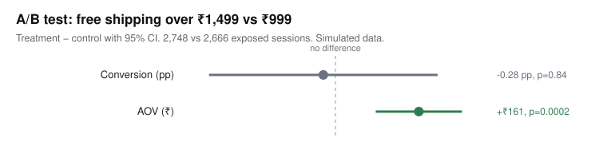
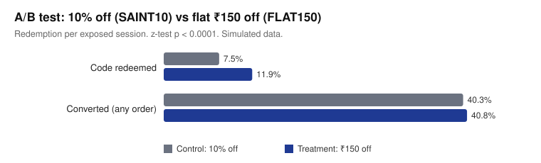
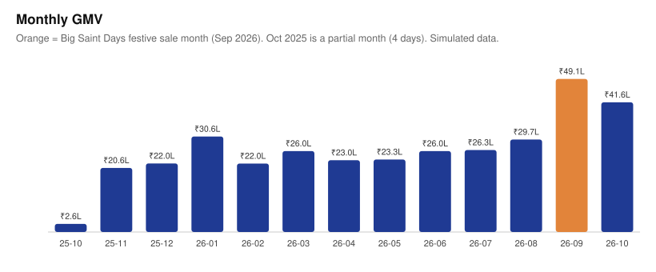

# Super Saint: e-commerce analysis report

> **All data in this report is simulated.** It was generated by `Backend/src/scripts/simulate.ts` with a fixed random seed (20261028), so every number is reproducible. The simulator's behavioural parameters (conversion probabilities, COD/RTO rates, experiment mechanisms, redemption rates) are **assumptions** listed in [Simulation assumptions](#simulation-assumptions). The analysis shows the method and tooling working end to end; the findings describe the simulated store, not a real business.

**Dataset:** 12 months (28 Oct 2025 – 27 Oct 2026, IST) · 463,465 sessions · 1,442,963 tracked events · 16,655 orders · 13,809 customers · 47 SKUs · ₹3.43 Cr GMV.

**How to reproduce:** `cd Backend && npm run analytics` (simulate → export to DuckDB → run SQL → build charts → tests). Query files are in [`analytics/sql`](../analytics/sql), results in [`analytics/results`](../analytics/results), and the numbers quoted here in [`report_numbers.json`](report_numbers.json).

**Metric definitions** (identical in SQL, the API and Power BI): GMV = sum of order totals placed (gross); AOV = GMV / orders; conversion = sessions with an order / sessions; repeat rate = buyers with 2+ non-cancelled orders / buyers; RTO = order returned to origin by the courier.

---

## 1. COD orders are lost 2.6× as often as prepaid orders

**Query:** [`08_payment_cancellation_rto.sql`](../analytics/sql/08_payment_cancellation_rto.sql), [`09_cod_rto_by_city.sql`](../analytics/sql/09_cod_rto_by_city.sql)

| | COD | Prepaid |
|---|---|---|
| Share of orders | 47.6% | 52.4% |
| Cancelled | 7.7% | 3.0% |
| RTO | **11.9%** | **2.1%** |
| Lost (cancelled + RTO + returned) | 23.6% | 9.0% |

- The RTO gap is highly significant: two-proportion z = 25.0, p < 0.0001.
- COD orders that were lost were worth **₹38.8 L of GMV**.
- 940 COD RTOs cost an estimated **₹1.69 L** in logistics, assuming ₹180 per RTO for forward plus reverse shipping.
- Five cities account for **34.9%** of COD RTOs: Delhi, Bengaluru, Mumbai, Ahmedabad and Hyderabad.

**Recommendation:** run a prepaid-incentive test in those five cities, for example ₹50 off for paying online, or a ₹49 COD fee on orders under ₹999.

- **Logistics alone don't justify it.** Each COD order moved to prepaid saves about ₹17 in RTO shipping (a 9.7-point lower RTO rate × ₹180).
- **Recovered revenue does.** The lost-order rate falls by 14.7 points, and at a ₹2,052 COD AOV and an *assumed* 50% gross margin that is worth about ₹150 per order moved.
- So any incentive under roughly ₹150 that actually moves shoppers to prepaid should pay back. Run it as the next A/B test with the existing module.

## 2. The biggest leak is product view → add to cart, and mobile converts worse

**Query:** [`03_funnel.sql`](../analytics/sql/03_funnel.sql)

- Of 454,347 sessions that viewed a product, 3.67% placed an order.
- **90.8% drop off before adding to cart.** That is far bigger than any later step: 46.7% of carts don't reach checkout, and 9.2% of payment attempts fail.
- Mobile view-to-order conversion is **3.43% vs 4.40% on desktop**, and mobile carries 70% of product-viewing sessions.

**Recommendation:** prioritise the mobile product page: size selection above the fold, sticky add-to-cart and faster images. Closing half the mobile/desktop gap would mean about **1,537 more orders a year**, roughly ₹31.6 L at the ₹2,057 average AOV (0.485 points × 316,910 mobile view sessions). Validate it with an A/B test before counting on it.

## 3. One in seven searches finds nothing, and those shoppers rarely buy

**Query:** [`11_search_terms.sql`](../analytics/sql/11_search_terms.sql), [`12_search_conversion.sql`](../analytics/sql/12_search_conversion.sql)

- **14.2% of searches return zero results.**
- Sessions whose only searches found nothing convert at **1.51%**, vs **4.44%** for sessions that saw results (p < 0.0001).
- The top unserved terms are "joggers" (5.2% of all searches), "socks" (2.6%), "cap" (1.7%) and "compression" (1.4%).

**Recommendation:** map "joggers" and "track pants" to the sweatpants as search synonyms now, at no cost. Then evaluate adding socks and caps as low-cost accessories. If zero-result sessions converted like the ones that found results, that would be about **537 more orders a year**, an upper bound because some of these shoppers want products we'll never stock.

## 4. Retention is the growth constraint: 14.5% repeat rate, and second orders come within a month

**Query:** [`04_cohort_retention.sql`](../analytics/sql/04_cohort_retention.sql), [`05_rfm_segments.sql`](../analytics/sql/05_rfm_segments.sql), [`07_repeat_purchase_interval.sql`](../analytics/sql/07_repeat_purchase_interval.sql)

- **Repeat rate:** 14.5% (1,907 of 13,185 buyers).
- **Cohort retention:** on average **6.2%** of a cohort orders again in month 1, 3.0% in month 3 and 1.1% in month 6.
- **Timing:** the median time to a second order is **31 days**. 49.6% of second orders arrive within 30 days and 72.4% within 60.
- **RFM:** the repeat-buying segments (Champions, Loyal, Potential Loyalists, At Risk) are 7.7% of customers but **16.9% of revenue**. *At Risk* is 99 customers who averaged 3.4 orders and ₹7,481 each but haven't bought in about 230 days.

**Recommendation:** trigger a second-order nudge (new drop, fit reminder or a time-limited free-shipping code) around **day 21–28** after the first delivery, the window where half of repeat purchases already happen. Run a personal win-back for the 99 At Risk customers, and exclude Hibernating customers (39% of the base) from paid retargeting.

## 5. A/B test: raising free shipping to ₹1,499 lifts AOV by ₹161 with no detectable conversion loss, but it's underpowered

**Query:** [`13_experiment_results.sql`](../analytics/sql/13_experiment_results.sql) · stats in [`stats.ts`](../Backend/src/analytics/stats.ts)

Setup: deterministic 50/50 split by visitor ID, exposure logged when the cart is shown, run 12 Aug – 24 Sep 2026, 2,748 control vs 2,666 treatment exposed sessions. Sample-ratio check: χ² p = 0.27, OK.

| Metric | ₹999 (control) | ₹1,499 (treatment) | Difference (95% CI) | p |
|---|---|---|---|---|
| Conversion (primary) | 38.61% | 38.33% | −0.28 pp (−2.87, +2.32) | 0.835 |
| AOV | ₹2,011 | ₹2,172 | **+₹161, +8.0%** (₹78, ₹244) | 0.0002 |
| Revenue / exposed session | ₹776 | ₹833 | +7.2% | 0.080 |
| Cancellation (guardrail) | 5.66% | 5.68% | +0.02 pp | 0.98 |

**Verdict: keep running.** The conversion confidence interval (−2.87 to +2.32 points) is still too wide to rule out a meaningful loss. Detecting a 5% relative change needs **10,072 sessions per arm**, and the test has 2,666 (26%). The AOV gain is real (Welch's t-test), but don't ship on a secondary metric while the primary one is unresolved.

*Simulation note:* the effect comes from an assumed mechanism. Below the free-shipping line, 30% of shoppers add another item and 12% abandon. Shoppers aren't told the effect; the analysis recovers it from their behaviour.

## 6. A/B test: flat ₹150 off is redeemed 60% more than 10% off, yet doesn't move conversion

**Query:** [`10_coupon_roi.sql`](../analytics/sql/10_coupon_roi.sql), [`13_experiment_results.sql`](../analytics/sql/13_experiment_results.sql)

- **Redemption:** shoppers shown **FLAT150** redeemed it in **11.9%** of exposed sessions, vs **7.5%** for **SAINT10** (10% off, capped at ₹300). p < 0.0001.
- **Conversion:** no difference, 40.8% vs 40.3% (p = 0.70).
- **Cost:** the flat code is cheaper per order, ₹150 vs ₹183 average discount.
- **Welcome coupon:** orders using WELCOME100 (14.4% of all orders) have an AOV **₹133 below** orders without a coupon. The festive BIGSAINT200 code, which requires ₹1,499+, has an AOV ₹355 above.

**Recommendation:**
- **Flat over percentage:** if a cart offer is used, prefer the flat ₹150 (cheaper per order, clearer to shoppers).
- **Neither code wins orders:** both mostly discount purchases that would have happened anyway. Treat cart coupons as a margin cost, not a growth lever.
- **Welcome code:** add a minimum basket (e.g. ₹1,299) to WELCOME100, following the pattern that works for BIGSAINT200.

*Simulation note:* redemption rates (20% vs 28% of checkouts) and small checkout nudges are simulator assumptions.

## 7. Festive sale doubles a month, but top sellers run out

**Query:** [`02_monthly_gmv_mom.sql`](../analytics/sql/02_monthly_gmv_mom.sql), [`06_product_performance_abc.sql`](../analytics/sql/06_product_performance_abc.sql)

- **Sale month:** September 2026, which contained Big Saint Days (a Big Billion Days-style sale), reached ₹49.1 L GMV, **+65.5% MoM**.
- **Revenue concentration:** 22 of 47 SKUs (47%) make up 80% of revenue (ABC class A).
- **Stock:** four class-A SKUs now have under two weeks of cover at last month's sales rate, including Essential Oversized Hoodie – Black with **0.9 days**, just as the winter season starts.

**Recommendation:** use the Products page's days-of-cover alert as the restock trigger, with a 21-day minimum cover for class-A SKUs ahead of sales and the Nov–Jan hoodie and quarter-zip season.

---

## Simulation assumptions

Everything below is an input to the simulator, set in [`Backend/src/scripts/sim/world.ts`](../Backend/src/scripts/sim/world.ts). Change them and re-run `npm run analytics` to see how the findings move.

| Area | Assumption |
|---|---|
| Traffic | 900 sessions/day base, +3.5% per month, weekend ×1.22–1.25, Big Saint Days ×3.2, end-of-season sale ×1.6 |
| Devices | 70% mobile, 24% desktop, 6% tablet; add-to-cart ×0.95 mobile, ×1.15 desktop |
| Funnel | add-to-cart 7.5% of sessions (×3 for returning buyers), checkout 50%, payment attempt 82%, payment success 97% COD / 86% online |
| Search | 28% of sessions search; 14% of those hit a term we don't stock |
| Payment mix | COD share 38% (metro) / 55% (tier 2) / 70% (tier 3), 10 points lower for returning buyers |
| Logistics | Cancellation 7.5% COD / 3% prepaid; RTO 10–20% COD by city tier, 2–3% prepaid; returns 5.5% / 4% |
| Retention | 60% of first-time buyers come back to browse (mean 40 days), 70% after a repeat order |
| Seasonality | Tanks/shorts peak Apr–Jun, hoodies/quarter-zips peak Nov–Jan |
| Free-shipping test | Below the threshold: 30% top up the cart, 12% abandon (same rule for both arms, different thresholds) |
| Coupon test | Redemption 20% (10% off) vs 28% (₹150 off) of checkouts; checkout nudge ×1.02 vs ×1.04 |
| RTO cost | ₹180 per RTO (forward + reverse logistics); gross margin 50% (insight 1 only) |
